# Vistas en SQL Server sobre SonoraDB

Álvaro García-Quismondo Lizana · Máster en IA y Big Data, Tajamar · 6 de octubre de 2026

## 1. Entorno y preparación

He trabajado en SQL Server Management Studio 22 conectado a la instancia por defecto de mi equipo (`localhost`), que es donde tengo `SonoraDB`. La barra de estado de SSMS muestra la versión 16.0 RTM, es decir, SQL Server 2022.

> El enunciado está pensado para SQL Server 2025. En mi equipo la instancia de 2025 (`SQL2025`) la uso para otro proyecto y no contiene `SonoraDB`, así que hice la práctica sobre la instancia de 2022. Nada de lo que se pide en esta sesión depende de funciones exclusivas de 2025 y todos los resultados coinciden con los esperados.

### 1.1 Punto de partida

Ejecuté el script de preparación del caso (`sql/00_preparacion.sql`). Carga las reproducciones y usuarios de las clases anteriores que falten y el lote del 22/09, comprobando por identificador para que se pueda ejecutar varias veces sin duplicar filas. La comprobación final devuelve 43 reproducciones y 10 usuarios.

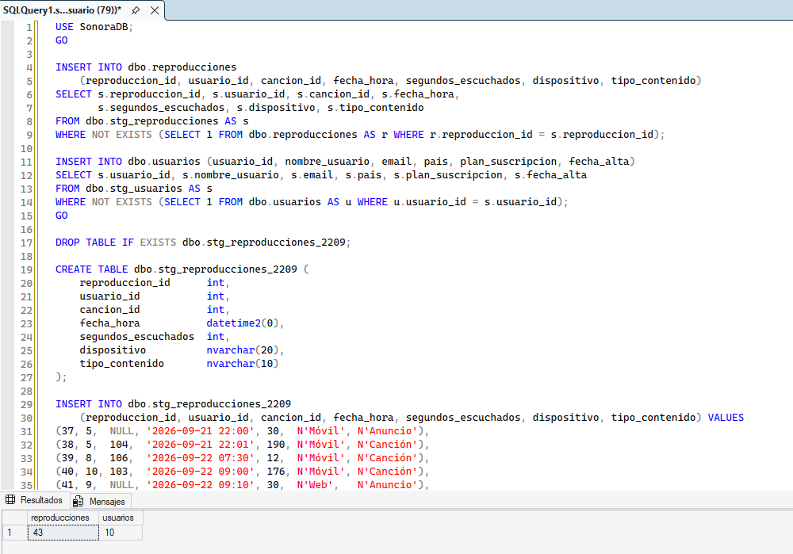

*Figura 1. Script de preparación y comprobación del punto de partida: 43 reproducciones y 10 usuarios.*

### 1.2 Vistas de la teoría

Los ejercicios se apoyan en las vistas creadas durante la parte teórica, así que antes de empezar las dejé creadas con `sql/01_vistas_teoria.sql`: `vw_reproducciones_validas`, `vw_usuarios_directorio`, `vw_reproducciones_detalle`, `vw_kpi_cancion`, `vw_genero_principal`, `vw_usuarios_free` (ya con `WITH CHECK OPTION`), `vw_catalogo_canciones` (con `SCHEMABINDING`) y la vista indexada `vw_ix_consumo_cancion` con su índice clustered único.

## 2. Ejercicios de refuerzo

Cada ejercicio tiene su script en `sql/ejercicios/`. Una reproducción se considera válida cuando es de tipo `Canción` y tiene al menos 30 segundos escuchados.

### 2.1 Ejercicio 1. Vista de anuncios

La vista `vw_anuncios` filtra las reproducciones de tipo `Anuncio` y expone solo las cuatro columnas pedidas. La agregación por dispositivo se hace al consultar la vista.

```sql
CREATE OR ALTER VIEW dbo.vw_anuncios
AS
SELECT reproduccion_id, usuario_id, fecha_hora, dispositivo
FROM dbo.reproducciones
WHERE tipo_contenido = N'Anuncio';
GO

SELECT dispositivo,
       COUNT(*)                   AS anuncios,
       COUNT(DISTINCT usuario_id) AS usuarios
FROM dbo.vw_anuncios
GROUP BY dispositivo
ORDER BY anuncios DESC, dispositivo;
```

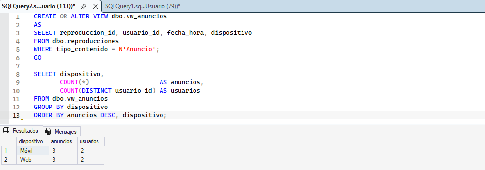

*Figura 2. Ejercicio 1. Anuncios emitidos y usuarios distintos por dispositivo.*

### 2.2 Ejercicio 2. Usuarios de pago

La vista deja fuera la columna `email` y filtra los planes `Premium` y `Familiar`. El orden por fecha de alta lo pone la consulta.

```sql
CREATE OR ALTER VIEW dbo.vw_usuarios_pago
AS
SELECT usuario_id, nombre_usuario, pais, plan_suscripcion, fecha_alta
FROM dbo.usuarios
WHERE plan_suscripcion IN (N'Premium', N'Familiar');
GO

SELECT usuario_id, nombre_usuario, pais, plan_suscripcion, fecha_alta
FROM dbo.vw_usuarios_pago
ORDER BY fecha_alta;
```

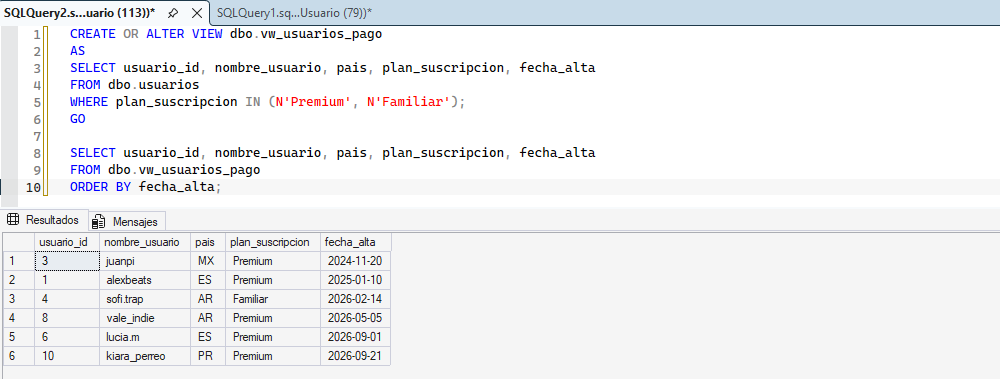

*Figura 3. Ejercicio 2. Usuarios de pago ordenados por fecha de alta.*

### 2.3 Ejercicio 3. Saltos

`vw_saltos` recoge las reproducciones de canciones con menos de 30 segundos. Para mostrar el nombre de usuario y el título uní la vista con `usuarios` y `canciones` en la consulta, igual que se haría con una tabla.

```sql
CREATE OR ALTER VIEW dbo.vw_saltos
AS
SELECT reproduccion_id, usuario_id, cancion_id, fecha_hora, segundos_escuchados
FROM dbo.reproducciones
WHERE tipo_contenido = N'Canción'
  AND segundos_escuchados < 30;
GO

SELECT u.nombre_usuario, c.titulo, s.segundos_escuchados, s.fecha_hora
FROM dbo.vw_saltos AS s
JOIN dbo.usuarios  AS u ON u.usuario_id = s.usuario_id
JOIN dbo.canciones AS c ON c.cancion_id = s.cancion_id
ORDER BY s.fecha_hora;
```

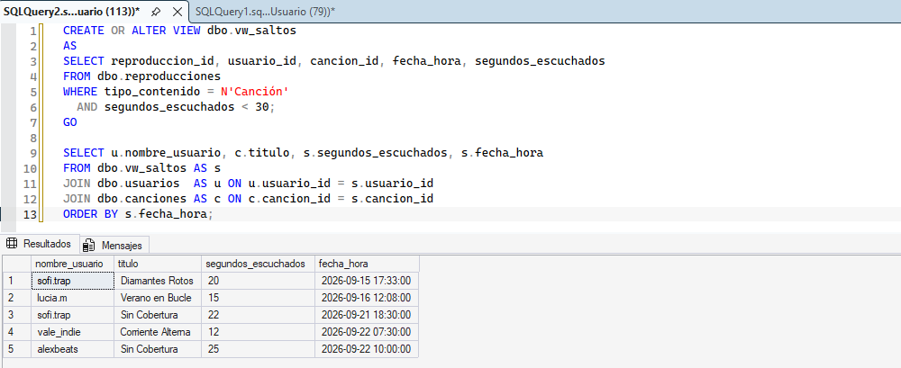

*Figura 4. Ejercicio 3. Los cinco saltos registrados, ordenados por fecha y hora.*

### 2.4 Ejercicio 4. Ficha de catálogo

```sql
CREATE OR ALTER VIEW dbo.vw_catalogo_detalle
AS
SELECT c.cancion_id,
       c.titulo,
       a.nombre AS artista,
       a.pais   AS pais_artista,
       g.nombre AS genero,
       c.duracion_seg,
       CAST(c.duracion_seg / 60.0 AS decimal(4,1)) AS duracion_min
FROM dbo.canciones AS c
JOIN dbo.artistas  AS a ON a.artista_id = c.artista_id
JOIN dbo.generos   AS g ON g.genero_id  = c.genero_id;
GO

SELECT titulo, artista, genero, duracion_seg, duracion_min
FROM dbo.vw_catalogo_detalle
WHERE pais_artista = 'ES'
ORDER BY titulo;
```

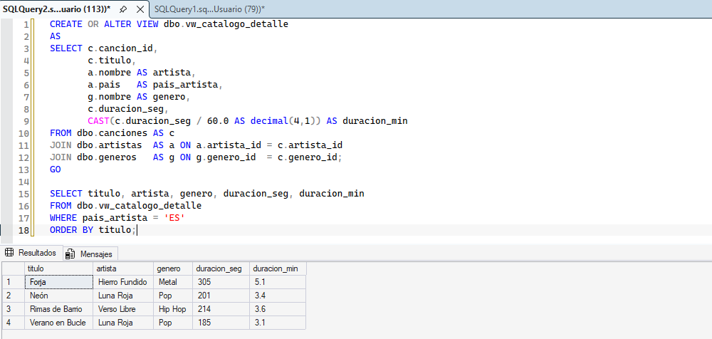

*Figura 5. Ejercicio 4. Canciones de artistas españoles.*

Sara Cometa no aparece porque no tiene ninguna canción en el catálogo. La vista parte de `canciones` y llega a `artistas` con un `JOIN` interno, así que un artista sin canciones no genera ninguna fila.

### 2.5 Ejercicio 5. Corregir la vista por dispositivo

La vista original tenía dos problemas. `COUNT(*)` no tenía alias, y en una vista todas las columnas necesitan nombre (Msg 4511). Además incluía `ORDER BY` sin `TOP` ni `OFFSET`, que no está permitido dentro de una vista (Msg 1033): la vista devuelve un conjunto sin orden y el orden lo pone quien la consulta.

```sql
CREATE OR ALTER VIEW dbo.vw_canciones_por_dispositivo
AS
SELECT dispositivo, COUNT(*) AS reproducciones
FROM dbo.reproducciones
WHERE tipo_contenido = N'Canción'
GROUP BY dispositivo;
GO

SELECT dispositivo, reproducciones
FROM dbo.vw_canciones_por_dispositivo
ORDER BY reproducciones DESC;
```

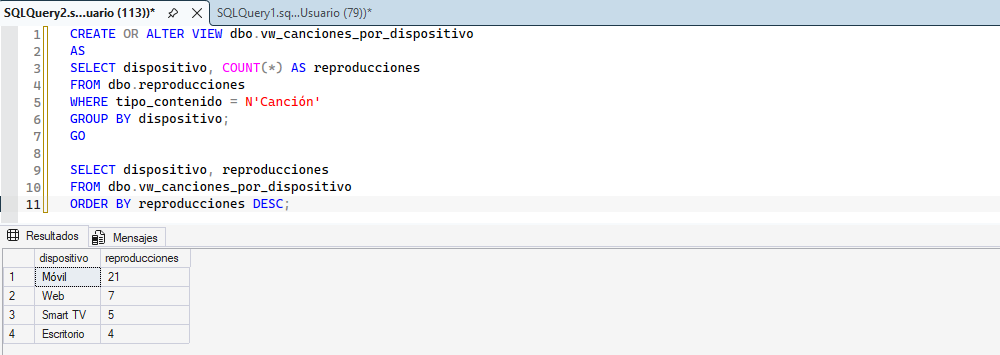

*Figura 6. Ejercicio 5. Vista corregida y consulta ordenada por reproducciones.*

### 2.6 Ejercicio 6. Indicadores por usuario

Para que aparezcan también los usuarios sin actividad, la vista parte de `usuarios` y se une con `vw_reproducciones_validas` mediante `LEFT JOIN`. `COUNT` sobre una columna de la vista derecha devuelve 0 cuando no hay coincidencias y `COALESCE` evita que los minutos salgan a `NULL`.

```sql
CREATE OR ALTER VIEW dbo.vw_kpi_usuario
AS
SELECT u.usuario_id,
       u.nombre_usuario,
       u.plan_suscripcion,
       u.pais,
       COUNT(v.reproduccion_id) AS reproducciones_validas,
       CAST(COALESCE(SUM(v.segundos_escuchados), 0) / 60.0 AS decimal(6,1)) AS minutos,
       MAX(v.fecha_hora) AS ultima_reproduccion_valida
FROM dbo.usuarios AS u
LEFT JOIN dbo.vw_reproducciones_validas AS v ON v.usuario_id = u.usuario_id
GROUP BY u.usuario_id, u.nombre_usuario, u.plan_suscripcion, u.pais;
GO

-- a)
SELECT nombre_usuario, plan_suscripcion, reproducciones_validas, minutos, ultima_reproduccion_valida
FROM dbo.vw_kpi_usuario
WHERE reproducciones_validas = 0;

-- b)
SELECT nombre_usuario, plan_suscripcion, reproducciones_validas, minutos
FROM dbo.vw_kpi_usuario
WHERE plan_suscripcion IN (N'Premium', N'Familiar')
ORDER BY minutos DESC;
```

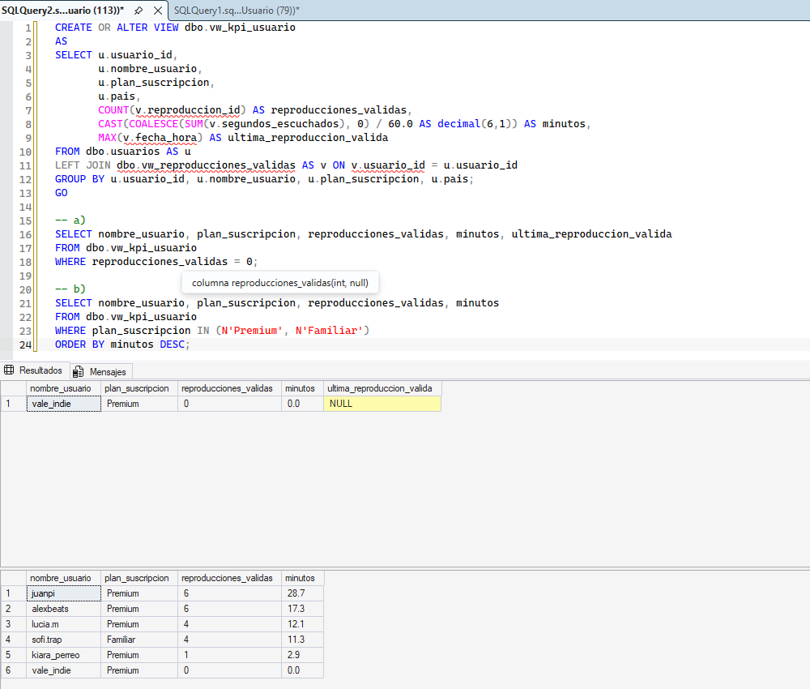

*Figura 7. Ejercicio 6. a) Usuarios sin reproducciones válidas. b) Usuarios de pago por minutos.*

vale_indie es la única usuaria sin reproducciones válidas: la canción que escuchó el 22/09 duró 12 segundos y cuenta como salto (aparece en el ejercicio 3). Por eso su última reproducción válida es `NULL`.

### 2.7 Ejercicio 7. Organigrama

La CTE recursiva se guarda tal cual dentro de la vista. El ancla es el empleado sin jefe (nivel 0) y la parte recursiva va concatenando la ruta. La ruta permite resolver el apartado a) con un `LIKE` que busca a Raúl Benet seguido de un separador, de modo que solo salen las personas que están por debajo de él.

```sql
CREATE OR ALTER VIEW dbo.vw_organigrama
AS
WITH org AS (
    SELECT empleado_id, nombre, puesto, 0 AS nivel,
           CAST(nombre AS nvarchar(500)) AS ruta
    FROM dbo.empleados
    WHERE jefe_id IS NULL

    UNION ALL

    SELECT e.empleado_id, e.nombre, e.puesto, o.nivel + 1,
           CAST(o.ruta + N' > ' + e.nombre AS nvarchar(500))
    FROM dbo.empleados AS e
    JOIN org AS o ON e.jefe_id = o.empleado_id
)
SELECT empleado_id, nombre, puesto, nivel, ruta
FROM org;
GO

-- a)
SELECT nombre, puesto, nivel
FROM dbo.vw_organigrama
WHERE ruta LIKE N'%Raúl Benet > %'
ORDER BY nombre;

-- b)
SELECT nivel, COUNT(*) AS empleados
FROM dbo.vw_organigrama
GROUP BY nivel
ORDER BY nivel;
```

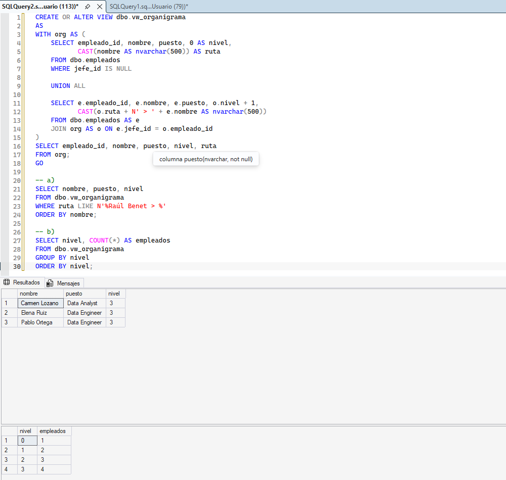

*Figura 8. Ejercicio 7. a) Dependientes de Raúl Benet. b) Empleados por nivel.*

### 2.8 Ejercicio 8. WITH CHECK OPTION en canciones de 2026

Antes de ejecutar, mi predicción fue la siguiente.

| Sentencia | Predicción | Motivo |
|---|---|---|
| a) | 1 fila | Humo Violeta es de 2026 y sigue siéndolo |
| b) | Msg 550 | La fila saldría del filtro de la vista |
| c) | 0 filas | Neón es de 2025 y no es visible en la vista |
| d) | Msg 550 | Se insertaría una fila fuera del filtro |
| e) | 1 fila | La fecha cumple el filtro |

```sql
CREATE OR ALTER VIEW dbo.vw_canciones_2026
AS
SELECT cancion_id, titulo, artista_id, genero_id, duracion_seg, fecha_lanzamiento
FROM dbo.canciones
WHERE fecha_lanzamiento >= '2026-01-01'
WITH CHECK OPTION;
GO

BEGIN TRAN;
GO
UPDATE dbo.vw_canciones_2026 SET duracion_seg = 170 WHERE titulo = N'Humo Violeta';
GO
UPDATE dbo.vw_canciones_2026 SET fecha_lanzamiento = '2025-12-15' WHERE titulo = N'Humo Violeta';
GO
UPDATE dbo.vw_canciones_2026 SET duracion_seg = 210 WHERE titulo = N'Neón';
GO
INSERT INTO dbo.vw_canciones_2026 (cancion_id, titulo, artista_id, genero_id, duracion_seg, fecha_lanzamiento)
VALUES (116, N'Eco Antiguo', 9, 2, 190, '2025-10-01');
GO
INSERT INTO dbo.vw_canciones_2026 (cancion_id, titulo, artista_id, genero_id, duracion_seg, fecha_lanzamiento)
VALUES (117, N'Primer Vuelo', 9, 2, 195, '2026-10-02');
GO
ROLLBACK;
GO

SELECT COUNT(*) AS canciones FROM dbo.canciones;
SELECT titulo, duracion_seg FROM dbo.canciones WHERE titulo = N'Humo Violeta';
```

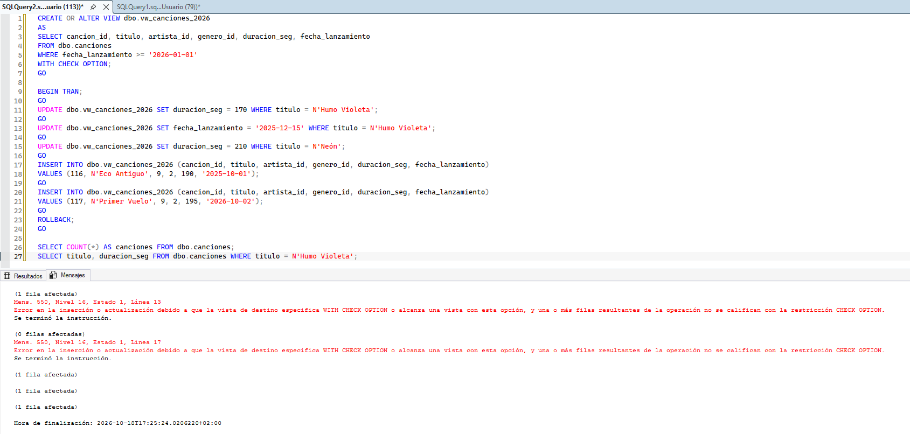

*Figura 9. Ejercicio 8. Mensajes de las cinco sentencias: 1 fila, Msg 550, 0 filas, Msg 550 y 1 fila.*

Los mensajes coinciden con la predicción. El caso c) no da error: el `UPDATE` sobre la vista solo ve las filas que cumplen su `WHERE`, así que Neón no se encuentra y no se toca.

### 2.9 Ejercicio 9. Modificar a través de una vista con JOIN

Mi predicción: a) funciona porque solo toca `canciones`; b) falla con Msg 4405 porque cambia columnas de dos tablas base en la misma sentencia; c) falla con Msg 4406 porque `duracion_min` es una expresión calculada; d) funciona porque solo toca `artistas`.

```sql
BEGIN TRAN;
GO
-- a)
UPDATE dbo.vw_catalogo_detalle SET duracion_seg = 205 WHERE titulo = N'Neón';
GO
-- b)
UPDATE dbo.vw_catalogo_detalle
SET titulo = N'Neón (Remix)', artista = N'Luna Roja & DJ Coral'
WHERE titulo = N'Neón';
GO
-- c)
UPDATE dbo.vw_catalogo_detalle SET duracion_min = 3.5 WHERE titulo = N'Neón';
GO
-- d)
UPDATE dbo.vw_catalogo_detalle SET artista = N'Luna Roja Oficial' WHERE titulo = N'Neón';
GO
SELECT titulo, artista, duracion_seg
FROM dbo.vw_catalogo_detalle
WHERE artista LIKE N'Luna Roja%'
ORDER BY titulo;
GO
ROLLBACK;
```

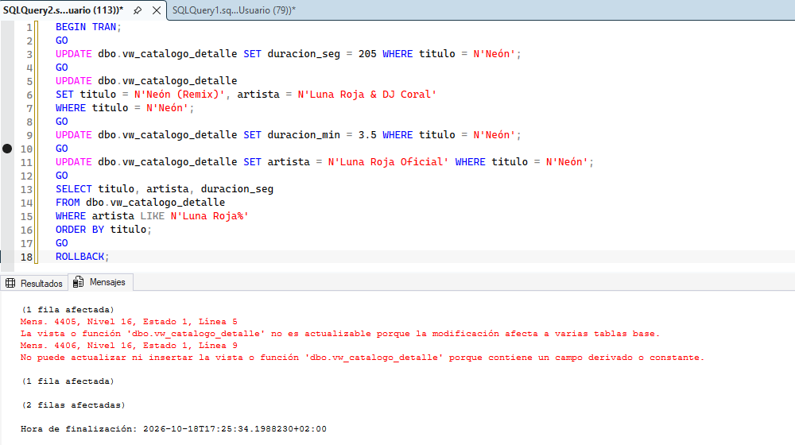

*Figura 10. Ejercicio 9. Mensajes: 1 fila, Msg 4405, Msg 4406 y 1 fila.*

Para la consulta previa al `ROLLBACK` volví a ejecutar la transacción solo con las dos sentencias que modifican datos, ya que las que fallan no cambian nada.

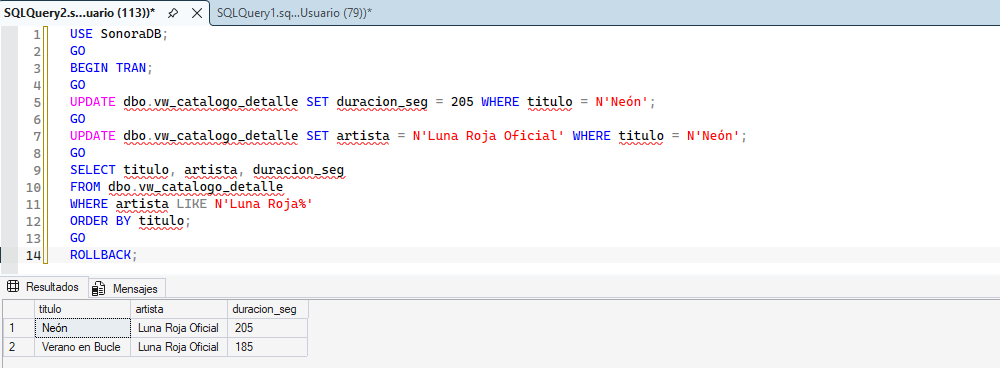

*Figura 11. Ejercicio 9. Canciones de Luna Roja antes del ROLLBACK.*

Verano en Bucle también aparece como Luna Roja Oficial porque la sentencia d) no modifica la canción, sino la fila de `artistas` a la que apunta Neón. Esa fila es la misma para todas las canciones de Luna Roja, así que el cambio se ve en todas.

### 2.10 Ejercicio 10. Ficha de artistas con SCHEMABINDING

La vista del compañero tenía tres problemas. `SELECT *` no está permitido en una vista enlazada al esquema (Msg 1054). La tabla `artistas` aparece sin esquema, y `SCHEMABINDING` exige nombres de dos partes (Msg 4512). Por último, el `*` sobre el `JOIN` traería columnas con el mismo nombre en las dos tablas, como `genero_id` y `nombre`, y una vista no admite nombres de columna repetidos.

```sql
CREATE OR ALTER VIEW dbo.vw_artistas_ficha
WITH SCHEMABINDING
AS
SELECT a.artista_id,
       a.nombre AS artista,
       a.pais,
       g.nombre AS genero
FROM dbo.artistas AS a
JOIN dbo.generos  AS g ON g.genero_id = a.genero_id;
GO

SELECT artista, pais, genero
FROM dbo.vw_artistas_ficha
WHERE pais = 'ES'
ORDER BY artista;
```

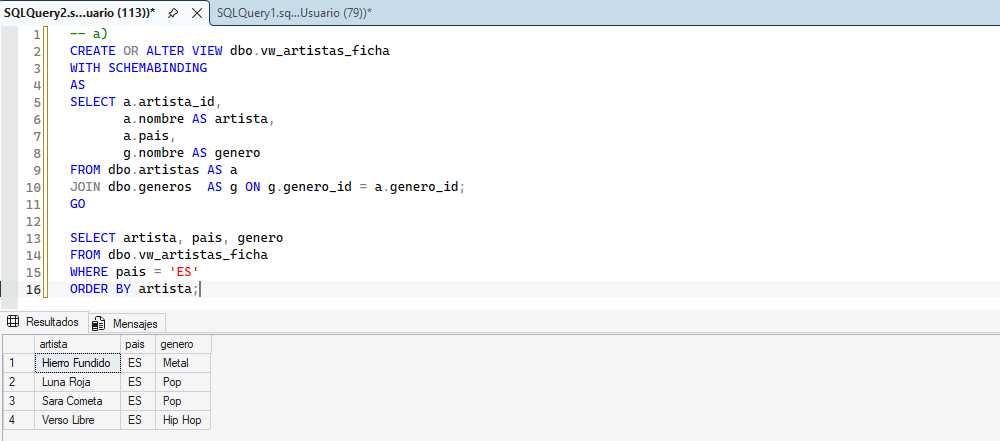

*Figura 12. Ejercicio 10 a). Artistas españoles; ahora sí aparece Sara Cometa.*

Sara Cometa sale aquí y no en el ejercicio 4 porque esta vista parte de `artistas`, no de `canciones`.

```sql
ALTER TABLE dbo.artistas ALTER COLUMN nombre nvarchar(150) NOT NULL;
```

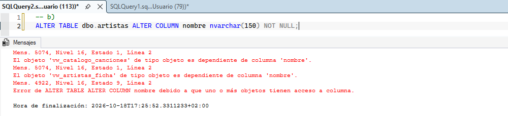

*Figura 13. Ejercicio 10 b). El cambio de columna se bloquea con dos Msg 5074 y un Msg 4922.*

Aparecen dos vistas porque hay dos objetos enlazados al esquema que usan `artistas.nombre`: la ficha que acabo de crear y `vw_catalogo_canciones` del ejemplo 11. Cada una genera su propio Msg 5074 y después llega el 4922 que cancela el `ALTER TABLE`.

```sql
SELECT referencing_schema_name, referencing_entity_name
FROM sys.dm_sql_referencing_entities(N'dbo.artistas', N'OBJECT')
ORDER BY referencing_entity_name;
```

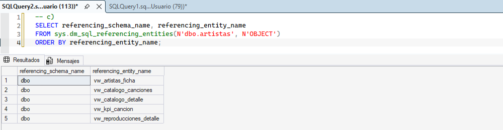

*Figura 14. Ejercicio 10 c). Vistas que dependen directamente de dbo.artistas.*

Las cinco vistas leen `artistas`, pero solo bloquean el cambio `vw_artistas_ficha` y `vw_catalogo_canciones`, que son las que tienen `SCHEMABINDING`. `vw_catalogo_detalle`, `vw_kpi_cancion` y `vw_reproducciones_detalle` no impiden nada: el `ALTER` se ejecutaría y, si el cambio les afectara, solo se notaría al consultarlas.

### 2.11 Ejercicio 11. Vista indexada por dispositivo

La vista original fallaba al crear el índice por dos motivos: `AVG` no está permitido en una vista indexada y, cuando hay `GROUP BY`, es obligatorio incluir `COUNT_BIG(*)`. La corrección guarda el número de reproducciones y la suma de segundos, y la media se calcula al consultar.

```sql
DROP VIEW IF EXISTS dbo.vw_ix_consumo_dispositivo;
GO

CREATE VIEW dbo.vw_ix_consumo_dispositivo
WITH SCHEMABINDING
AS
SELECT dispositivo,
       COUNT_BIG(*)             AS reproducciones_validas,
       SUM(segundos_escuchados) AS segundos
FROM dbo.reproducciones
WHERE tipo_contenido = N'Canción'
  AND segundos_escuchados >= 30
GROUP BY dispositivo;
GO

CREATE UNIQUE CLUSTERED INDEX IX_vw_ix_consumo_dispositivo
    ON dbo.vw_ix_consumo_dispositivo (dispositivo);
GO

SELECT dispositivo,
       reproducciones_validas,
       CAST(segundos / 60.0 AS decimal(6,1))                          AS minutos,
       CAST(segundos * 1.0 / reproducciones_validas AS decimal(6,1)) AS media_segundos
FROM dbo.vw_ix_consumo_dispositivo WITH (NOEXPAND)
ORDER BY reproducciones_validas DESC, dispositivo;
```

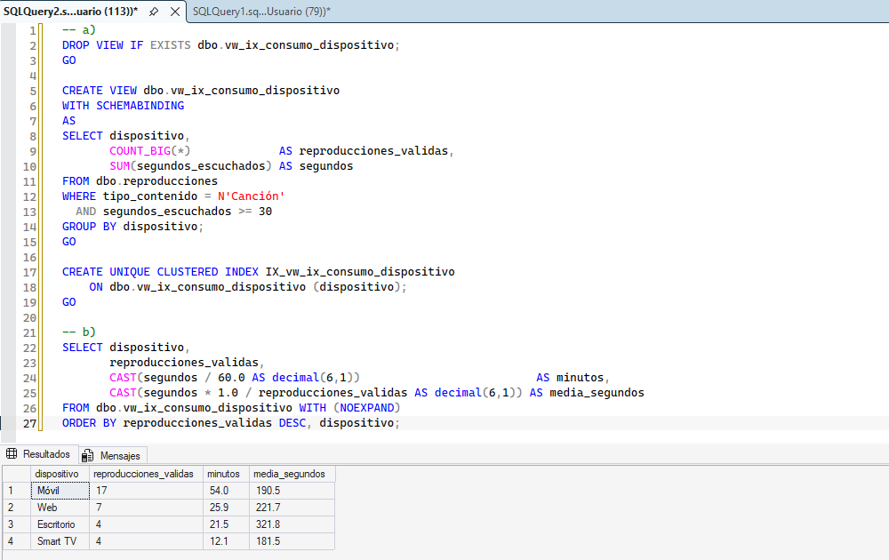

*Figura 15. Ejercicio 11 a) y b). Vista indexada consultada con NOEXPAND.*

```sql
BEGIN TRAN;

INSERT INTO dbo.reproducciones
    (reproduccion_id, usuario_id, cancion_id, fecha_hora, segundos_escuchados, dispositivo, tipo_contenido)
VALUES (44, 6, 102, '2026-09-22 21:00', 201, N'Smart TV', N'Canción');

SELECT dispositivo, reproducciones_validas, segundos
FROM dbo.vw_ix_consumo_dispositivo WITH (NOEXPAND)
WHERE dispositivo = N'Smart TV';

ROLLBACK;
```

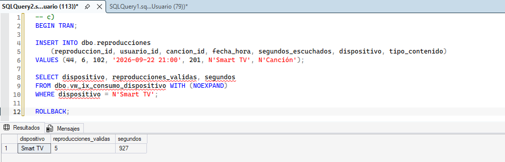

*Figura 16. Ejercicio 11 c). Tras insertar la reproducción 44, Smart TV pasa a 5 reproducciones y 927 segundos.*

Smart TV tenía 4 reproducciones y 726 segundos. Al insertar una reproducción válida de 201 segundos, el resultado guardado se actualiza en la misma transacción, sin refrescar nada. El `ROLLBACK` lo deja todo como estaba.

## 3. Caso de estudio: vistas para el cuadro de mando

Todo el caso está en `sql/caso/01_caso_sonora_vistas_bi.sql`, que se puede ejecutar varias veces: las vistas se crean con `CREATE OR ALTER` y las pruebas que modifican datos van dentro de transacciones que terminan en `ROLLBACK`. El `ALTER TABLE` del requerimiento 6, que falla a propósito, y el procedimiento para hacer ese cambio están en dos scripts aparte.

### 3.1 Requerimiento 1. Tabla de hechos de reproducciones válidas

La vista solo lee tablas y resuelve el género principal con su propia CTE recursiva, sin depender de `vw_genero_principal`. Cada canción tiene un único género y cada género un único género principal, por lo que los `JOIN` no multiplican filas.

```sql
CREATE OR ALTER VIEW dbo.vw_bi_hechos_reproduccion
AS
WITH arbol AS (
    SELECT genero_id, genero_id AS raiz_id
    FROM dbo.generos
    WHERE genero_padre_id = (SELECT genero_id FROM dbo.generos WHERE genero_padre_id IS NULL)

    UNION ALL

    SELECT g.genero_id, a.raiz_id
    FROM dbo.generos AS g
    JOIN arbol AS a ON g.genero_padre_id = a.genero_id
)
SELECT r.reproduccion_id,
       CAST(r.fecha_hora AS date) AS fecha,
       r.fecha_hora,
       u.usuario_id,
       u.nombre_usuario,
       u.pais          AS pais_usuario,
       u.plan_suscripcion,
       c.titulo,
       a.nombre        AS artista,
       g.nombre        AS genero,
       gp.nombre       AS genero_principal,
       r.dispositivo,
       r.segundos_escuchados
FROM dbo.reproducciones AS r
JOIN dbo.usuarios  AS u  ON u.usuario_id = r.usuario_id
JOIN dbo.canciones AS c  ON c.cancion_id = r.cancion_id
JOIN dbo.artistas  AS a  ON a.artista_id = c.artista_id
JOIN dbo.generos   AS g  ON g.genero_id  = c.genero_id
JOIN arbol         AS ar ON ar.genero_id = c.genero_id
JOIN dbo.generos   AS gp ON gp.genero_id = ar.raiz_id
WHERE r.tipo_contenido = N'Canción'
  AND r.segundos_escuchados >= 30;
GO

-- Comprobación: una fila por reproducción válida
SELECT (SELECT COUNT(*) FROM dbo.vw_bi_hechos_reproduccion)                       AS filas_vista,
       (SELECT COUNT(DISTINCT reproduccion_id) FROM dbo.vw_bi_hechos_reproduccion) AS ids_distintos,
       (SELECT COUNT(*) FROM dbo.reproducciones
        WHERE tipo_contenido = N'Canción' AND segundos_escuchados >= 30)          AS validas_tabla;

-- Resumen por país
SELECT pais_usuario,
       COUNT(*)                   AS reproducciones,
       COUNT(DISTINCT usuario_id) AS oyentes,
       CAST(SUM(segundos_escuchados) / 60.0 AS decimal(6,1)) AS minutos
FROM dbo.vw_bi_hechos_reproduccion
GROUP BY pais_usuario
ORDER BY reproducciones DESC, pais_usuario;
GO
```

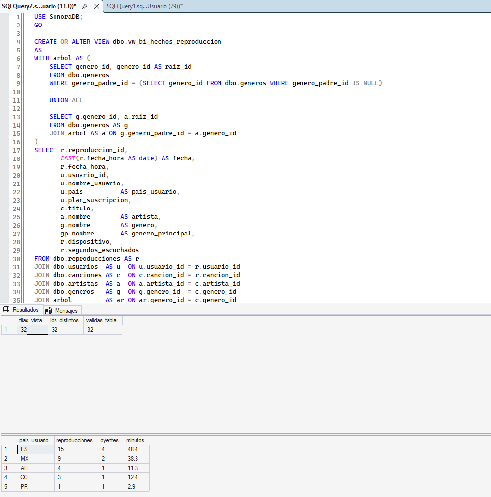

*Figura 17. Requerimiento 1. Comprobación de una fila por reproducción válida y resumen por país.*

La comprobación devuelve 32 en las tres columnas: la vista tiene tantas filas como reproducciones válidas hay en la tabla y no repite ningún identificador. España concentra 15 de las 32 reproducciones válidas.

### 3.2 Requerimiento 2. Evolución diaria

```sql
CREATE OR ALTER VIEW dbo.vw_bi_kpi_diario
AS
SELECT fecha,
       COUNT(*)                   AS reproducciones_validas,
       COUNT(DISTINCT usuario_id) AS oyentes,
       CAST(SUM(segundos_escuchados) / 60.0 AS decimal(6,1)) AS minutos
FROM dbo.vw_bi_hechos_reproduccion
GROUP BY fecha;
GO

SELECT fecha, reproducciones_validas, oyentes, minutos
FROM dbo.vw_bi_kpi_diario
WHERE fecha BETWEEN '2026-09-16' AND '2026-09-22'
ORDER BY fecha;
GO
```

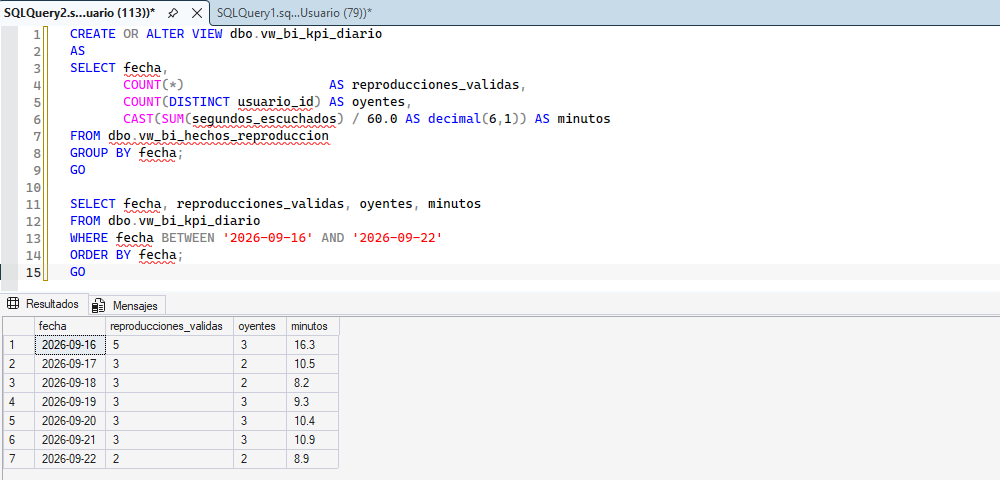

*Figura 18. Requerimiento 2. Indicadores diarios de la semana de análisis.*

La vista se construye sobre la del requerimiento 1, así que hereda la regla de reproducción válida sin repetirla. El filtro de la semana lo pone la consulta, no la vista, para que Power BI pueda pedir cualquier otro rango.

### 3.3 Requerimiento 3. Indicadores por género principal

Para que salgan los cuatro géneros principales aunque alguno no tenga actividad, la vista parte de `generos` filtrando los hijos directos de la raíz y une los hechos con `LEFT JOIN`.

```sql
CREATE OR ALTER VIEW dbo.vw_bi_kpi_genero_principal
AS
SELECT g.nombre                     AS genero_principal,
       COUNT(h.reproduccion_id)     AS reproducciones_validas,
       COUNT(DISTINCT h.usuario_id) AS oyentes,
       CAST(COALESCE(SUM(h.segundos_escuchados), 0) / 60.0 AS decimal(6,1)) AS minutos
FROM dbo.generos AS g
LEFT JOIN dbo.vw_bi_hechos_reproduccion AS h ON h.genero_principal = g.nombre
WHERE g.genero_padre_id = (SELECT genero_id FROM dbo.generos WHERE genero_padre_id IS NULL)
GROUP BY g.nombre;
GO

SELECT genero_principal, reproducciones_validas, oyentes, minutos
FROM dbo.vw_bi_kpi_genero_principal
ORDER BY reproducciones_validas DESC;
GO
```

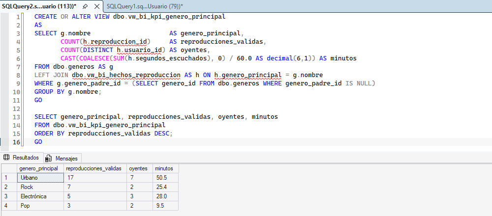

*Figura 19. Requerimiento 3. Acumulado histórico por género principal.*

Las cifras coinciden con las del ejemplo 6 de la teoría (17, 7, 5 y 3), que calculaba lo mismo por otro camino.

### 3.4 Requerimiento 4. Rendimiento de canciones

Aquí no puedo usar la vista de hechos porque solo contiene reproducciones válidas y hacen falta también los saltos. La vista parte de `canciones` con `LEFT JOIN` a `reproducciones`, y el filtro de tipo va en el `ON` para no perder las canciones sin reproducciones. `NULLIF` convierte el denominador 0 en `NULL`, de modo que una canción sin reproducciones tiene tasa `NULL` en lugar de provocar un error de división entre cero.

```sql
CREATE OR ALTER VIEW dbo.vw_bi_rendimiento_canciones
AS
SELECT c.cancion_id,
       c.titulo,
       a.nombre AS artista,
       c.fecha_lanzamiento,
       COUNT(r.reproduccion_id)                                  AS reproducciones_totales,
       COUNT(CASE WHEN r.segundos_escuchados >= 30 THEN 1 END)   AS reproducciones_validas,
       COUNT(CASE WHEN r.segundos_escuchados <  30 THEN 1 END)   AS saltos,
       CAST(100.0 * COUNT(CASE WHEN r.segundos_escuchados < 30 THEN 1 END)
            / NULLIF(COUNT(r.reproduccion_id), 0) AS decimal(5,1)) AS tasa_salto
FROM dbo.canciones AS c
JOIN dbo.artistas AS a ON a.artista_id = c.artista_id
LEFT JOIN dbo.reproducciones AS r
       ON r.cancion_id = c.cancion_id
      AND r.tipo_contenido = N'Canción'
GROUP BY c.cancion_id, c.titulo, a.nombre, c.fecha_lanzamiento;
GO

SELECT titulo, artista, reproducciones_totales, reproducciones_validas, saltos, tasa_salto
FROM dbo.vw_bi_rendimiento_canciones
WHERE saltos > 0
ORDER BY tasa_salto DESC;
GO
```

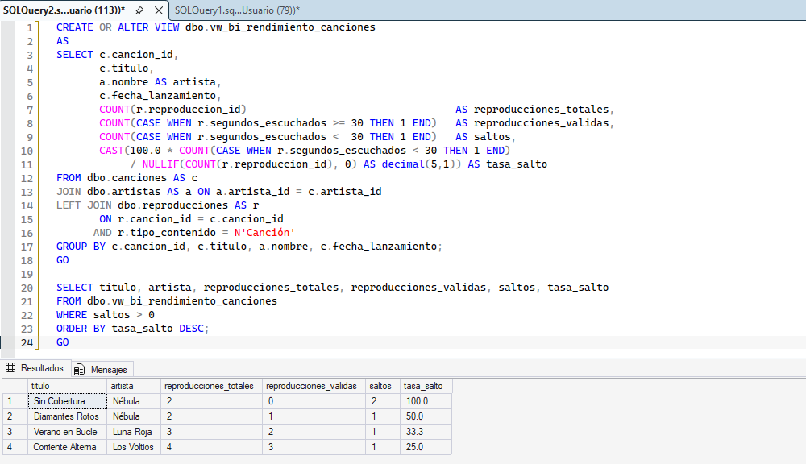

*Figura 20. Requerimiento 4. Canciones con algún salto, ordenadas por tasa de salto.*

Sin Cobertura tiene dos reproducciones y las dos son saltos, por eso encabeza la lista con una tasa del 100 %.

### 3.5 Requerimiento 5. Mantenimiento de usuarios LATAM

La vista no incluye `email` y filtra los cuatro mercados LATAM. `WITH CHECK OPTION` impide que una modificación hecha a través de ella deje a un usuario fuera de ese filtro.

```sql
CREATE OR ALTER VIEW dbo.vw_usuarios_latam
AS
SELECT usuario_id, nombre_usuario, pais, plan_suscripcion, fecha_alta
FROM dbo.usuarios
WHERE pais IN ('MX', 'AR', 'CO', 'PR')
WITH CHECK OPTION;
GO

SELECT usuario_id, nombre_usuario, pais, plan_suscripcion, fecha_alta
FROM dbo.vw_usuarios_latam
ORDER BY pais, nombre_usuario;
GO
```

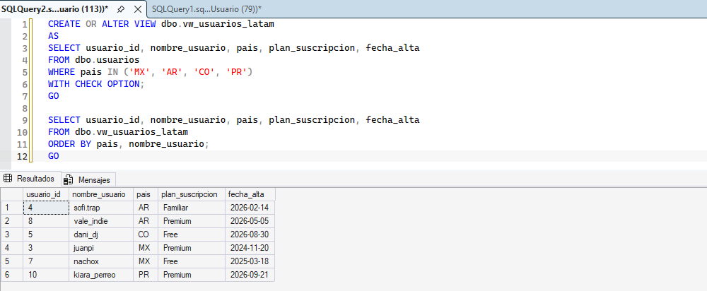

*Figura 21. Requerimiento 5. Usuarios LATAM ordenados por país y nombre.*

```sql
BEGIN TRAN;
GO
-- a) Permitido
UPDATE dbo.vw_usuarios_latam SET plan_suscripcion = N'Premium' WHERE nombre_usuario = N'nachox';
GO
-- b) Bloqueado por CHECK OPTION
UPDATE dbo.vw_usuarios_latam SET pais = 'ES' WHERE nombre_usuario = N'juanpi';
GO
-- c) marta_rock no es visible en la vista
UPDATE dbo.vw_usuarios_latam SET plan_suscripcion = N'Premium' WHERE nombre_usuario = N'marta_rock';
GO
ROLLBACK;
GO
```

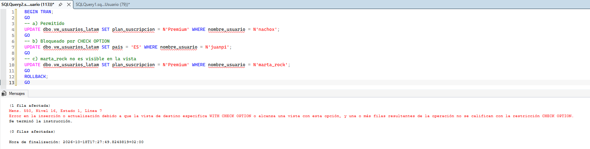

*Figura 22. Requerimiento 5. Cambio de plan permitido, cambio de país bloqueado y marta_rock sin filas afectadas.*

El cambio de plan de nachox se aplica porque sigue siendo de México. El cambio de país de juanpi lo rechaza `CHECK OPTION` con Msg 550. El `UPDATE` sobre marta_rock no da error, pero afecta a 0 filas porque es una usuaria de España y la vista no la ve: el equipo LATAM no puede modificarla ni por error.

### 3.6 Requerimiento 6. Consumo por país y plan, enlazado al esquema

```sql
CREATE OR ALTER VIEW dbo.vw_bi_consumo_pais_plan
WITH SCHEMABINDING
AS
SELECT u.pais AS pais_usuario,
       u.plan_suscripcion,
       COUNT_BIG(*) AS reproducciones_validas,
       CAST(SUM(r.segundos_escuchados) / 60.0 AS decimal(6,1)) AS minutos
FROM dbo.reproducciones AS r
JOIN dbo.usuarios AS u ON u.usuario_id = r.usuario_id
WHERE r.tipo_contenido = N'Canción'
  AND r.segundos_escuchados >= 30
GROUP BY u.pais, u.plan_suscripcion;
GO

SELECT pais_usuario, plan_suscripcion, reproducciones_validas, minutos
FROM dbo.vw_bi_consumo_pais_plan
ORDER BY minutos DESC;
GO
```

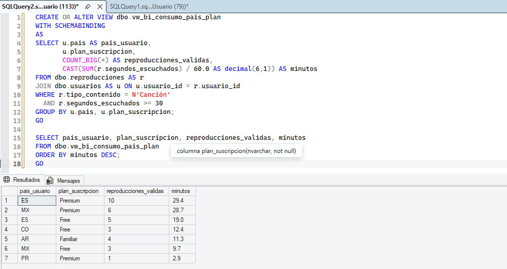

*Figura 23. Requerimiento 6. Consumo por país y plan ordenado por minutos.*

A continuación ejecuté el cambio que pide Backend.

```sql
ALTER TABLE dbo.usuarios ALTER COLUMN plan_suscripcion nvarchar(30) NOT NULL;
```

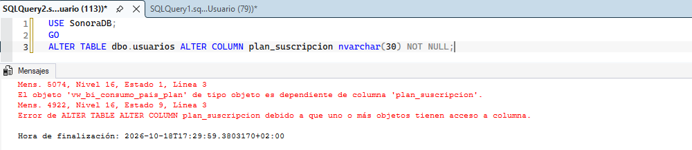

*Figura 24. Requerimiento 6. La ampliación de plan_suscripcion se bloquea.*

SQL Server rechaza el `ALTER TABLE` con Msg 5074, que nombra a `vw_bi_consumo_pais_plan` como dependiente de la columna, y Msg 4922. La vista está enlazada al esquema y usa `plan_suscripcion`, así que la columna no se puede modificar mientras exista el enlace. El cuadro de mando sigue funcionando porque el cambio no llega a aplicarse.

Para hacer el cambio sin dejar el cuadro de mando roto, los pasos son quitar temporalmente el `SCHEMABINDING` de la vista, ampliar la columna, volver a crear la vista enlazada y refrescar con `sp_refreshview` las vistas no enlazadas que exponen la columna, para que sus metadatos recojan el nuevo tamaño. Lo hice todo en una sola transacción, de forma que si un paso falla no queda nada a medias.

```sql
BEGIN TRAN;

-- 1. Quitar temporalmente el enlace
EXEC (N'CREATE OR ALTER VIEW dbo.vw_bi_consumo_pais_plan
AS
SELECT u.pais AS pais_usuario, u.plan_suscripcion,
       COUNT_BIG(*) AS reproducciones_validas,
       CAST(SUM(r.segundos_escuchados) / 60.0 AS decimal(6,1)) AS minutos
FROM dbo.reproducciones AS r
JOIN dbo.usuarios AS u ON u.usuario_id = r.usuario_id
WHERE r.tipo_contenido = N''Canción'' AND r.segundos_escuchados >= 30
GROUP BY u.pais, u.plan_suscripcion;');

-- 2. Ampliar la columna
ALTER TABLE dbo.usuarios ALTER COLUMN plan_suscripcion nvarchar(30) NOT NULL;

-- 3. Volver a enlazar la vista
EXEC (N'CREATE OR ALTER VIEW dbo.vw_bi_consumo_pais_plan
WITH SCHEMABINDING
AS
SELECT u.pais AS pais_usuario, u.plan_suscripcion,
       COUNT_BIG(*) AS reproducciones_validas,
       CAST(SUM(r.segundos_escuchados) / 60.0 AS decimal(6,1)) AS minutos
FROM dbo.reproducciones AS r
JOIN dbo.usuarios AS u ON u.usuario_id = r.usuario_id
WHERE r.tipo_contenido = N''Canción'' AND r.segundos_escuchados >= 30
GROUP BY u.pais, u.plan_suscripcion;');

-- 4. Refrescar metadatos de las vistas no enlazadas que exponen la columna
EXEC sp_refreshview N'dbo.vw_bi_hechos_reproduccion';
EXEC sp_refreshview N'dbo.vw_usuarios_latam';

SELECT c.name, t.name AS tipo, c.max_length / 2 AS longitud
FROM sys.columns AS c
JOIN sys.types AS t ON t.user_type_id = c.user_type_id
WHERE c.object_id = OBJECT_ID(N'dbo.usuarios') AND c.name = N'plan_suscripcion';

ROLLBACK;
GO
```

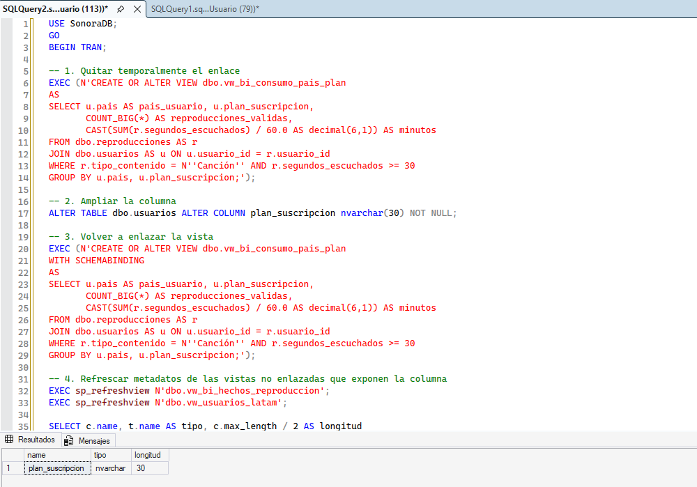

*Figura 25. Requerimiento 6. Dentro de la transacción la columna ya es nvarchar(30).*

> Dejé el procedimiento con `ROLLBACK` para no cambiar `SonoraDB` respecto a lo que esperan las sesiones siguientes. En un despliegue real terminaría en `COMMIT`. `CREATE VIEW` tiene que ser la primera sentencia de su lote, por eso las dos versiones de la vista se crean con `EXEC` dentro de la transacción.

### 3.7 Requerimiento 7. Mapa de dependencias

```sql
-- a)
SELECT referencing_schema_name, referencing_entity_name
FROM sys.dm_sql_referencing_entities(N'dbo.reproducciones', N'OBJECT')
WHERE referencing_entity_name LIKE N'vw[_]bi[_]%'
ORDER BY referencing_entity_name;

-- b)
SELECT referencing_schema_name, referencing_entity_name
FROM sys.dm_sql_referencing_entities(N'dbo.vw_bi_hechos_reproduccion', N'OBJECT')
ORDER BY referencing_entity_name;
```

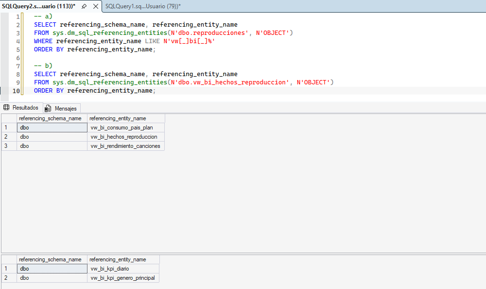

*Figura 26. Requerimiento 7. a) Vistas vw_bi_ que leen dbo.reproducciones. b) Vistas que leen vw_bi_hechos_reproduccion.*

Si cambia la regla de reproducción válida hay que tocar las tres vistas del apartado a), porque las tres la escriben: `vw_bi_hechos_reproduccion` y `vw_bi_consumo_pais_plan` en su `WHERE`, y `vw_bi_rendimiento_canciones` en los `CASE` que separan válidas de saltos. Las dos del apartado b) no hay que tocarlas: heredan la regla de la vista de hechos. `vw_bi_consumo_pais_plan` es la única con `SCHEMABINDING`, así que no lee de la vista de hechos y tiene que repetir la regla.

## 4. Conclusión

Lo que más me ha costado ver es que una vista con `JOIN` sí se puede actualizar mientras cada sentencia toque una sola tabla, y que eso puede cambiar filas que no parecen afectadas, como pasó con Verano en Bucle. También he comprobado que `SCHEMABINDING` protege el cuadro de mando a cambio de obligar a repetir la regla de negocio y a planificar cualquier cambio de columna.

## Estructura de la entrega

```
Vistas_Sonora.pdf
README.md
img/        capturas de SSMS
sql/00_preparacion.sql
sql/01_vistas_teoria.sql
sql/ejercicios/ej01 ... ej11
sql/caso/01_caso_sonora_vistas_bi.sql   script re-ejecutable del caso
sql/caso/02_r6_alter_bloqueado.sql      ALTER que falla a propósito
sql/caso/03_r6_cambio_controlado.sql    procedimiento para ampliar la columna
```
